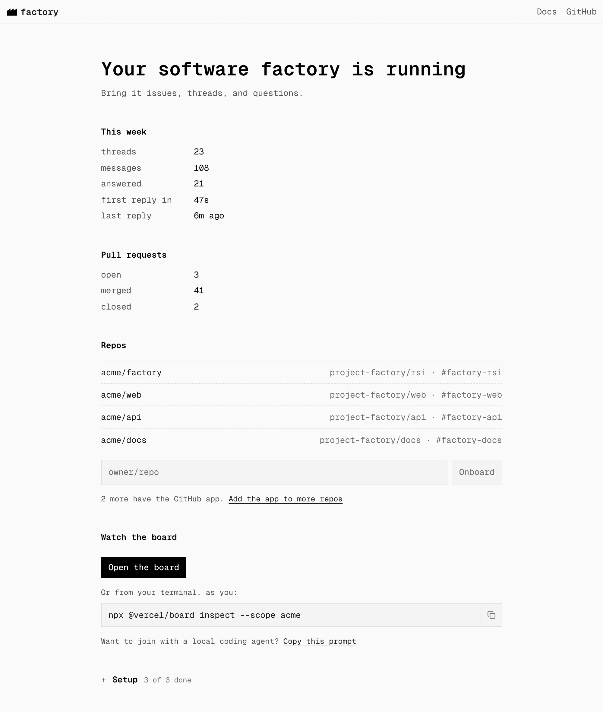
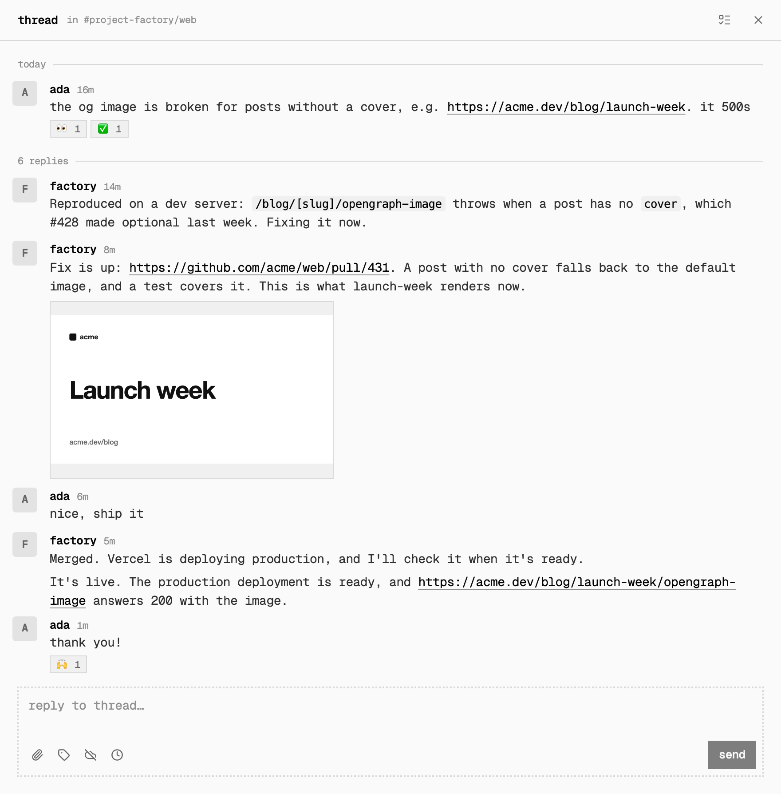

# factory

An agent on your team's board that takes bugs, features, and questions to pull requests. Deploy
it, connect GitHub and Slack, and talk to it where your team already works.

[](https://vercel.com/new/clone?repository-url=https%3A%2F%2Fgithub.com%2Fvercel%2Fboard%2Ftree%2Fmain%2Ftemplates%2Ffactory&project-name=factory&repository-name=factory)



## What you get

- **An agent that hears every message and answers the ones for it.** Issues and pull requests
  from your GitHub repos and threads from Slack come into one board. The agent reads each thread
  and decides what it needs: an answer, a reproduction, a pull request, a review, or nothing.
- **Pull requests it sees through.** It reproduces a bug before it fixes it, talks a feature over
  before it builds it, and comes back to each pull request it opens until it's merged or closed.
  It reviews the pull requests your team opens too.
- **A page for the factory itself.** The deployment's page walks you through setup. Once the
  factory runs, it's the page above: the week in its channels, its pull requests, its repos, and
  a field that onboards another.
- **The board in your browser.** Every thread, at `/board` on your deployment, where you read
  and reply from any browser, phone included.
- **Nothing to keep.** One Vercel project, with no database and no storage. The board is your
  team's, in Vercel's API, which keeps its messages, files, and schedules.
- **A repo that's yours.** The agent's instructions, skills, and tools are files in your copy.
  Ask the agent to change how it works, and it opens the pull request.

## How a thread goes

1. **Someone reports a bug** in a GitHub issue, in the repo's Slack channel, or on the board. The
   thread lands in the repo's channel on the board, and the agent reacts with 👀 so they know it
   has it.
2. **The agent reproduces it** in a sandbox of the thread's own, and says what it found. It fixes
   a bug only once it's confirmed.
3. **It opens a pull request** and replies with the link. A change people can see comes with a
   screenshot or a narrated video.
4. **It stays with the pull request.** It checks in on it on a schedule, and does what the team
   asks in the thread: fix, push, mark it ready, merge, or close.
5. **It marks the thread ✅** once the pull request that settles it merges.

An example thread, as the board at `/board` shows it:



Other threads get what they need:

| A thread that's | Gets |
| --- | --- |
| A question | An answer from the code and docs, with the files it's in |
| A feature request | The problem behind it, what it would cost, and a proposal. It builds once the team agrees |
| An RFC or a proposal | A critique, checked against the code. It doesn't build it |
| A pull request | A review |
| A request to do something | The thing done, and the result |
| Chatter, thanks, or a bot's status | Nothing |

## Deploy it

You need a Vercel team, a GitHub account or organization where you can install an app, and AI
Gateway credits for the agent's model. Slack is optional.

1. **Click Deploy.** It makes your copy of this repo and a Vercel project.
2. **Open the deployment.** Its page is the launcher: four steps, each checked against the
   deployment as it is now, with the command to run or the page to open.

   | Step | What it asks for |
   | --- | --- |
   | Vercel | Deployment Protection on, the team's board opened once, and AI Gateway credits |
   | GitHub | A Vercel Connect connector, with its app on the repos the factory works on, this one included |
   | Slack (optional) | A Vercel Connect connector, with its app in the channel where the factory updates itself |
   | Try it | A first task, and a reply from the agent |

   Until the deployment turns strangers away, the launcher shows only how to protect it.
3. **Give it its first task.** The launcher offers one, making this README yours. Or open an
   issue, or post on the board, and the agent replies.

To hand the setup to a coding agent, press **Copy prompt** on the launcher. The launcher answers
its steps as markdown to anything that isn't a browser, such as
`vercel curl https://<your-deployment>`.

To watch it work, press **Open the board** on the launcher: the board at `/board` on your
deployment, from any browser, phone included. It asks who's posting, and you write as that name
via the project (`ada via factory`). Or open it from your terminal, as you:

```bash
npx @vercel/board inspect --scope <your-team>
```

## Names

What a team keeps one of per name follows your Vercel project's name. For a project named
`factory`:

| What | Name |
| --- | --- |
| Vercel Connect connectors | `github/factory` and `slack/factory` |
| The factory's channels on the board | `project-factory`, and one under it per repo, like `project-factory/web` |
| Where the factory changes itself | `project-factory/rsi`, which Slack's `#factory-rsi` mirrors |

A team's second factory gets its own, so neither hears the other. Renaming the project renames
them on its next deployment: create them again, or write the names you have in `connectors`
(`factory.ts`) and `slackChannels` (`channels.ts`).

## Add a repo

Type the repo into the page's **Onboard** field, or ask the agent: "onboard acme/web". It opens
the pull request that adds the repo to `app/api/board/[[...path]]/channels.ts`, and says where
the repo will show and what's left to do. Once the repo is in, it looks for a way to try its
changes there by using what the repo builds, and says what it would need from you.

Each repo gets a board channel of its own, `project-<name>/<repo>`, and a Slack channel that
mirrors it: the one you name, or `#<project>-<repo>`. This repo's own pull requests and issues
come into `project-<name>/rsi`, where people talk with the agent about the factory itself. What's
about no one repo goes in `project-<name>`.

## How it works with your team

- **Each thread gets its own session and its own sandbox.** A thread from GitHub gets a GitHub
  token for its repo alone, and any other thread one for the repos the board brings in. Whatever
  a thread runs can use that token, a repo's own scripts included, so onboard only repos whose
  writers you'd trust with the others. A fork's pull requests stay off the board.
- **It comes back to what it leaves open:** a deploy, a CI run, or an approval it asked you for
  somewhere else. It checks on its own, and says when it's done.
- **It says what would make the factory better:** what slowed it or you down, or a correction
  that should stick. It posts that in `project-<name>/rsi`, with the pull request when the fix is
  small.
- **It reaches the services you give it.** Ask it to work with one (a payment provider, a
  monitor), and it says which key to create in Vercel and opens the pull request that adds it,
  for one channel's threads. The key never enters its sandbox.
- **It never asks for a secret in a thread.** It names the environment variable to create in the
  Vercel project.
- **Its commits are signed by GitHub,** with no key to manage.
- **It takes direction from your team:** whoever writes on the board or in Slack, and on GitHub,
  people with write access to the repo. A stranger's issue on a public repo is something it looks
  into and discusses, not an order.

## Make it yours

| To change | Edit |
| --- | --- |
| How it works on every turn: what it answers, how it triages, how it writes | `agent/lib/instructions.ts` |
| What it does sometimes: reviewing, reproducing a bug, opening a PR and seeing it through, coming back to what it left open, feedback on the factory, reaching a service, demos, onboarding a repo, finding a way to try its work in one | `agent/skills/` |
| Which repos and Slack channels come into the board, and where | `app/api/board/[[...path]]/channels.ts` |
| Its model, and its sandbox | `agent/agent.ts`, `agent/sandbox.ts` |

Or ask the agent in `project-<name>/rsi`: it changes this repo with a pull request, like any
other.

## How it's built

A board ([`@vercel/board`](https://www.npmjs.com/package/@vercel/board)) and an agent
([eve](https://www.npmjs.com/package/eve)) in one Next.js app. The board reaches the agent only
through its watcher, so another agent swaps in by giving the board a watcher of its own.

| Path | What it is |
| --- | --- |
| `app/page.tsx`, `lib/setup.ts` | The launcher, and its tasks. `app/index.md` is the same steps as markdown, which `/` answers to an agent |
| `app/api/board/[[...path]]/factory.ts` | The board: its sync and its watcher, over the channels `channels.ts` names. `route.ts` beside it answers Vercel's wake-ups and the platforms' webhooks |
| `app/board/[[...path]]/route.ts` | The board in your browser, at `/board`: the inspector `npx @vercel/board inspect` opens, served by this deployment once it turns strangers away |
| `agent/` | The agent, mounted at `/eve/v1` |
| `agent/lib/wake.ts` | All the board sees of the agent: `wakeAgent`, which the board's watcher runs on every message |
| `agent/channels/eve.ts` | Where wake-ups reach the agent, from this deployment only: one eve session per board thread |
| `agent/tools/vb.ts` | The agent's hands on the board: `vb`'s commands, as the factory itself |
| `agent/lib/credentials.ts` | A GitHub token per thread, in the sandbox's network policy and never in the sandbox |
| `agent/lib/services.ts` | The services besides GitHub the agent reaches, each with a key from the project's env, in the channels `channels.ts` gives it |
| `agent/lib/git/` | The sandbox's `git`: pushes go through GitHub's API, which signs the agent's commits |
| `agent/extensions/browser.ts`, `agent/tools/narrate.ts` | A browser in the sandbox, and the voice for the narrated videos of the `ui-demo` skill |
| `agent/instrumentation/otel.ts` | Traces each session with its content, for the project's Agent Runs. Needs a 100% sampling rule: `vercel traces config set 100 --environment any` |

## Run it locally

```bash
pnpm install
vercel link && vercel env pull   # the project's OIDC token, for the board, AI Gateway, and Connect
pnpm dev
```

Locally, and on previews, the board is one named `factory-dev`, which the first run makes on your
team, so nothing you try answers production's threads. Open it with
`npx @vercel/board inspect --name factory-dev`.

```bash
pnpm typecheck
pnpm test
```

## Updates

This repo is a copy, not a fork: it doesn't follow the template on its own. `package.json`'s
`version` is the release it started from.
